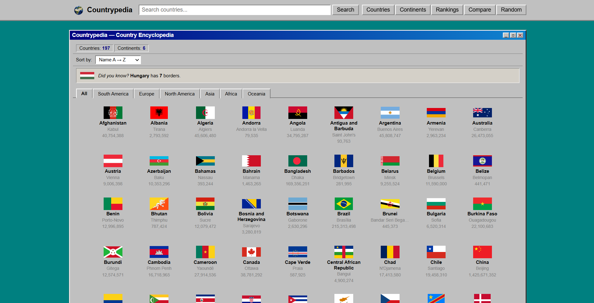
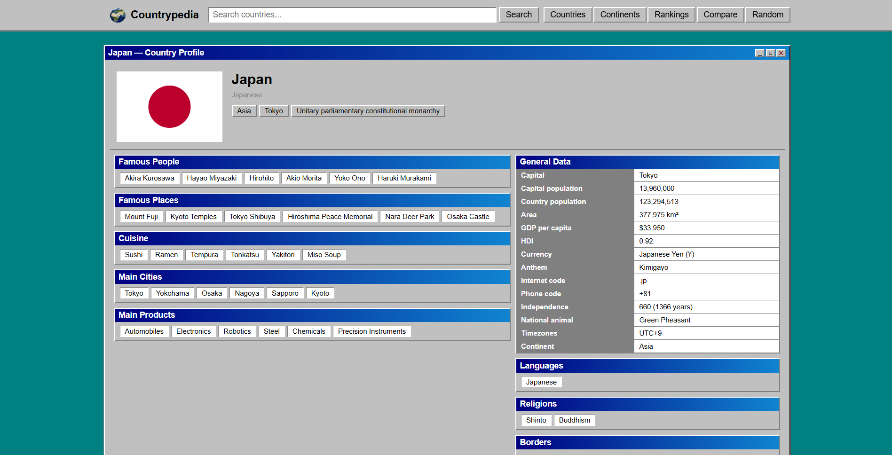
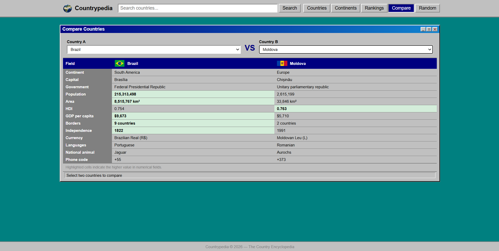

# Countrypedia

### The country encyclopedia — every nation, one click away.


🔗 **Live site:** [marcondezvictor.github.io/Countrypedia](https://marcondezvictor.github.io/Countrypedia/)

<!--
  SCREENSHOTS — save images in docs/screenshots/ and uncomment the lines below.
  Suggested: home.png (country grid), country.png (a country page), compare.png (comparison)

<p align="center">
  
</p>

| Country page | Compare |
|---|---|
|  |  |
-->

---

## What it does

Countrypedia brings the key facts of **197 countries** into a single, fast, retro-styled site inspired by the Windows 95 look.

- **Countries** — searchable, sortable list with flags for every country
- **Country page** — capital, population, languages, currency, government, GDP per capita, HDI, borders, cuisine, famous places and more
- **Continents** — browse countries continent by continent
- **Rankings** — top countries by population, area, GDP and HDI
- **Compare** — put two countries side by side; the better value is highlighted
- **Random** — jump to a random country and discover something new
- **Responsive** — works on desktop and mobile

## Tech stack

Pure **HTML, CSS and JavaScript** — no frameworks, no build step, no backend.
All country data lives in a single JavaScript dataset, and flags are local SVG files.

## Run locally

```bash
git clone https://github.com/MarcondezVictor/Countrypedia.git
cd Countrypedia
```

Then open `index.html` in your browser — or serve the folder for cleaner paths:

```bash
npx serve .
```

## Project structure

```
index.html        # Home — country grid with search and sorting
pages/            # countries, country, continents, stats (rankings), compare
js/               # page logic (one file per page)
script.js         # country dataset
style.css         # all styles (Win95-inspired theme)
flags/            # SVG flags by ISO code (e.g. pt.svg)
images/           # logo and continent images
```

## What I learned

- Structuring a multi-page site without a framework, sharing one dataset across pages
- Building dynamic UIs with the DOM API (rendering, filtering, sorting, comparisons)
- Responsive layouts with Flexbox and CSS Grid
- Designing a data model and keeping a large dataset consistent

---

**Victor Hugo** — [github.com/MarcondezVictor](https://github.com/MarcondezVictor)

_Built as the final project for the Internet Technologies course at Instituto Politécnico de Tomar._
